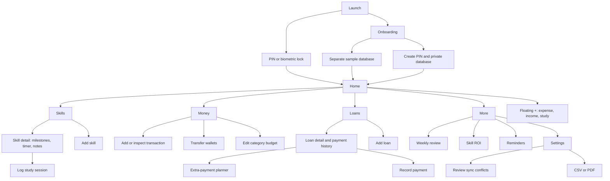

# Bruce’s Life UI

The selected direction is [Quiet Momentum](../design/bruce-life/01-quiet-momentum-v2.png): deep navy, mint progress, readable money, rounded surfaces, generous spacing, and a calm personal voice. The implementation is portrait-first, with a 480-point maximum preview width, safe-area padding, and five bottom tabs.

## Screen connections

Main routes are `/`, `/skills`, `/money`, `/loans`, and `/more`. Detail/form routes return through Back; successful saves return to the prior screen. Onboarding and lock gates conceal the entire navigation stack.

## Small design system

Tokens are in `apps/mobile/src/theme.tsx`; reusable controls are in `apps/mobile/src/ui.tsx`.

| Role | Dark | Light |
|---|---|---|
| Background | `#0C1424` | `#F6F8FB` |
| Card | `#172238` | `#FFFFFF` |
| Raised surface | `#1E2C45` | `#EAF0F7` |
| Main text | `#F3F6FA` | `#142239` |
| Secondary text | `#AAB9CD` | `#526276` |
| Income/progress | `#77E3B2` | `#187653` |
| Expense/overdue | `#FF8F91` | `#B74748` |
| Upcoming dues | `#F2C66D` | `#956009` |
| Border | `#2A3A50` | `#DCE3EC` |

Manrope is bundled, with regular, semibold, bold, and extra-bold weights. Screen headings are 28–34; key money values 24–32; body 16; secondary text 12–14. Amounts use tabular numbers, exact integer strings, and `RWF 25,000` formatting. Percentages and charts show bounded ratios; the underlying money remains bigint. Full amounts appear alongside charts rather than large-value axes.

Cards use 20-point corners and padding. Primary buttons are mint/green, secondary buttons use a raised surface and border, destructive buttons use red, and quiet actions use text on transparent backgrounds. Main controls have at least 44-point touch targets. Fields have labels and helpful hints; actions expose screen-reader roles and selected/checked states. Color is paired with labels, amounts, and icons.

Ionicons provide consistent 18–28-point outline icons. Core spacing is 8, 12, 16, 20, 22, and 24. A 54-point floating + sits above the tab bar on primary screens. Forms remain scrollable with the keyboard; the app uses native safe-area insets. Dark mode is the default, with a persistent light-mode option.

## Interaction notes

- **+** opens a bottom quick-entry sheet. Expense and income select their toggle in advance; study opens skill/minutes entry. Tapping outside or Cancel closes it.
- **Wallet** filters transactions; tapping again or Clear wallet filter restores all wallets. Transfer creates paired entries, updating both balances together.
- **Transaction save** updates SQLite immediately and remembers the wallet after a successful write. Undo soft-deletes an ordinary entry and recalculates balances. Payment/transfer legs remain linked.
- **Budget card** opens its editor. Progress turns amber at 80% and red at 100%; the server’s once-per-month alert records prevent repeated cloud alerts.
- **Skill card** opens milestones, timer, hours, notes, and course cost. Checking a milestone updates weighted progress. Finish timer logs actual elapsed whole minutes; notes persist locally.
- **Loan card** opens balance, schedule, and history. The extra-payment slider/exact field updates the simulation. Record payment commits the payment, expense, and balance change atomically; excessive amounts show an error.
- **Sync status** distinguishes offline, online/on-device, pending, syncing, retry, conflict, and successfully synced states. Manual Sync reports errors without discarding the queue. Financial conflicts require a visible choice.
- **Reminders** ask permission on native only when enabled. Quiet-hour reminders move to the end of quiet hours. Browser preview saves reminder settings without claiming delivery.
- **Settings** changes appearance/timezone, enables PIN/biometrics, exports data, and optionally signs into an existing account. Theme and drafts survive app reloads.

Empty skill/transaction views offer a clear first step. A saved study session gets a small encouraging message; streak milestones appear in the Home progress context. Rendering, focus behavior, and layout on real devices still need visual QA; no browser testing was performed at the user’s request.
